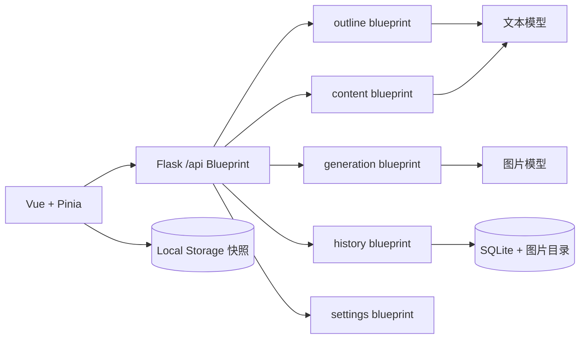

# 灵感创作台

一个本地运行的 AI 图文创作工作台。工作流是：输入一句话 → 自动生成多页大纲 → 用户编辑 → 图片模型逐页生成完整图片 → 单页重绘/生成标题正文 → 历史恢复与图片下载。

## 技术结构

- 前端：Vue 3、TypeScript、Vite、Vue Router、Pinia。
- 后端：Flask 应用工厂和功能 Blueprint；入口在 `studio/webapp.py`，接口模块位于 `studio/blueprints/`。
- 文本模型：OpenAI 兼容接口，默认 DeepSeek。
- 图片模型：OpenAI 图片生成兼容接口，默认 Seedream；模型负责生成带文字的完整卡片图片。
- 持久化：Pinia 的可序列化快照保存在 Local Storage；大纲、文案、图片文件和状态由 `/api/history` 保存到 SQLite/本地文件。导出 ZIP 仅包含图片。

## 运行

在项目根目录双击 `start_studio.bat`。开发者首次准备环境时按 [部署说明](docs/DEPLOYMENT.md) 安装 Python 依赖，并在 `frontend` 目录运行 `npm ci && npm run build`。

在“模型设置”页填写文本和图片模型接口。密钥只写入本机 `.env.card-model`，不会放进 Local Storage、历史记录或前端构建文件。不要在没有授权的情况下调用付费模型；这里只检查代码构建和本地页面，不自动生成图片。

## 维护前端

先从 [frontend/README.md](frontend/README.md) 入门。前端源码位于 `frontend/src`，构建后的文件位于 `studio/static/vue-app/assets/`。

## 模块图

## 项目文档

- [部署与本地运行](docs/DEPLOYMENT.md)
- [产品设计记录（历史）](docs/PRODUCT.md)
- [项目规划（历史）](docs/ROADMAP.md)
- [变更记录](docs/CHANGELOG.md)
- [问题记录](docs/BADCASES.md)
