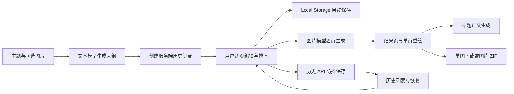

# RedInk 前端源码阅读记录

**分析版本：** RedInk `427efb1da0e90d0343debc7bee77142f556da813`。以下基于 `E:\aiPM\redink\frontend\src` 的 Vue、TypeScript、CSS 与 API 源文件，不以 README 的描述代替实现。

## 前端总体结构

`src/main.ts` 创建 Vue 应用，注册 Pinia 和 Vue Router，再加载 `variables.css`、`base.css`、`components.css`、`home.css`、`history.css`。`App.vue` 提供侧栏、RouterView 和非首页页脚，并在挂载后调用 `setupAutoSave()`。

路由集中在 `src/router/index.ts`：`/` 首页、`/outline` 大纲编辑、`/generate` 生成过程、`/result` 成果、`/history` 及 `/history/:id` 历史、`/settings` 设置。路由本身不携带完整创作数据；跨页面数据由 Pinia Store 持有。

## 页面与组件调用链

| RedInk 源文件 | 页面职责与关键行为 |
| --- | --- |
| `views/HomeView.vue` | 收集主题和上传图片；调用 `generateOutline()`；成功后写入 Store 并调用 `createHistory()`，再进入 `/outline`。 |
| `components/home/ComposerInput.vue` | 首页输入控件、图片选择/预览、输入长度与快捷示例；通过组件事件把主题和文件交还页面。 |
| `components/home/ShowcaseBackground.vue` | 首页装饰背景，不参与生成状态。 |
| `views/OutlineView.vue` | 修改页文案、拖拽排序、增删页面；深度监听大纲，延迟约 300ms 调 `updateHistory()`，生成前强制保存。 |
| `views/GenerateView.vue` | 进入时运行 `useGenerationRunner()`；订阅 `/generate` 的 SSE 事件，逐张更新状态；`useGenerationRestore()` 先尝试从历史恢复。 |
| `composables/useGenerationRunner.ts` | 确认历史记录、初始化逐页占位、消费 progress/complete/error/finish；成功后跳转结果页，卸载时清理定时器。 |
| `composables/useGenerationRestore.ts` | 通过历史详情检查已有图片；将服务端大纲、任务、文件名和进度重新灌入 Store。 |
| `composables/useImageRetry.ts` | 单页重绘和批量补失败图；把结果写回对应图片项，不重置其他页面。 |
| `views/ResultView.vue` | 展示图片、预览单图、逐页重绘、单张下载和 ZIP 下载；嵌入 `ContentDisplay.vue` 管理标题、正文和标签。 |
| `components/result/ContentDisplay.vue` | 调用 `generateContent()`；展示/编辑候选标题、正文、标签，并负责对应保存交互。 |
| `views/HistoryView.vue` | 调历史分页列表和统计；切换全部/完成/草稿、搜索、分页、删记录；可打开作品图库和大纲，恢复记录到编辑流程。 |
| `components/history/StatsOverview.vue` | 历史统计展示。 |
| `components/history/GalleryCard.vue` | 单条历史记录卡片、封面和操作入口。 |
| `components/history/ImageGalleryModal.vue` | 历史作品图片预览、逐张重绘和下载。 |
| `components/history/OutlineModal.vue` | 历史大纲查看。 |
| `views/SettingsView.vue` | 文本/图片服务商列表、激活、增删改、连接测试。 |
| `components/settings/ProviderTable.vue` | 服务商表格。 |
| `components/settings/ProviderModal.vue` | 文本服务配置弹窗。 |
| `components/settings/ImageProviderModal.vue` | 图片服务配置弹窗。 |
| `composables/useProviderForm.ts` | 设置页表单、服务商增删改、激活和测试请求。 |
| `components/common/ErrorCard.vue` | 统一错误展示与关闭操作。 |

## Store、浏览器存储和服务端历史

`stores/generator.ts` 是唯一的跨页面创作 Store。核心字段包括 `stage/topic/outline/progress/images/taskId/recordId/userImages/content/outlineStatus/lastSavedAt`。页面操作集中为 `setOutline/updatePage/deletePage/addPage/insertPage/movePage/startGeneration/updateProgress/updateImage/finishGeneration/reset` 等 action。

Store 直接读取 `localStorage['generator-state']` 初始化；`saveState()` 只序列化可恢复的字段，不保存 `File[]`；`setupAutoSave()` 深度监听 Store 并调用 `saveToStorage()`。因此它是前端刷新恢复兜底，不代替服务端历史。

大纲创建成功即调用 `POST /api/history`；后续编辑调用 `PUT /api/history/:id`；生成过程通过 `POST /api/generate` 的 SSE 推送进度，同时服务端记录任务与图片文件名；恢复时调用 `GET /api/history/:id`；历史页通过 `GET /api/history`、搜索/统计/删除接口管理记录；ZIP 从 `GET /api/history/:id/download` 获取。浏览器 Local Storage 保存当前编辑快照，后端历史 API 保存可搜索、可跨浏览器恢复的作品记录。

API 按 `api/outline.ts`、`image.ts`、`content.ts`、`history.ts`、`config.ts` 拆分；`api/client.ts` 收敛基础 URL、错误归一化和 SSE 解析。页面不会直接拼接所有接口细节。

## 从源码看到的产品流程

## 关键实现特点与仿写边界

1. 阶段是路由页面，创作对象放在 Pinia；不是用一个巨大 HTML 页切换 class。
2. 大纲、图片进度、内容、任务 ID 与历史 ID 共用同一个 Store，页面刷新后能恢复。
3. 浏览器保存和服务端历史同时工作；服务端恢复优先核对记录和已完成图片，避免只相信浏览器快照。
4. 批量生成是 SSE 流，单页失败有独立重试；失败数据不要求整组重做。
5. 历史页本身是完整工作区，支持统计、检索、筛选、翻页、预览、恢复与删除。
6. 设置页管理文本和图片 Provider，而不是把模型地址写在页面组件里。

Yimei 的新实现按这些**职责边界与交互机制**独立重写，使用自己的页面文案、样式、提示词和服务端实现；没有复制 RedInk 的 Vue 代码、CSS、图标或品牌资产。RedInk 仓库声明 CC BY-NC-SA 4.0，本实现继续遵循独立创作边界。
